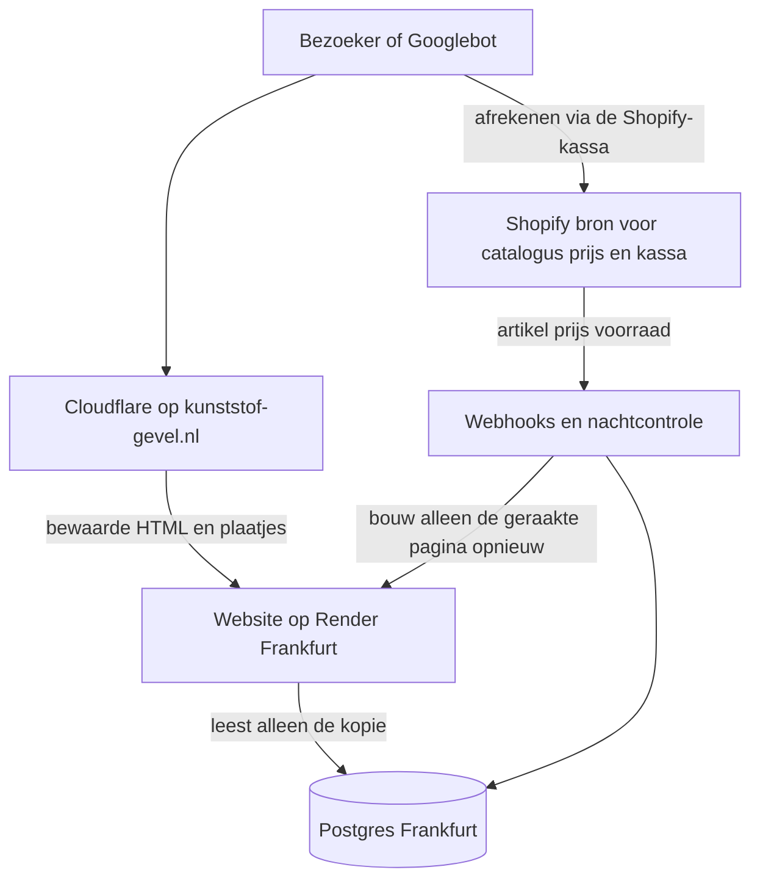

# Plan: snelheid en rookgordijn

Voor Ruben. Dit is een plan, geen bouwopdracht. De site, de checkout en PR #13 blijven zoals ze zijn.

Shopify (`ajfust-8f.myshopify.com`) blijft de bron voor catalogus, prijzen en afrekenen. De pagina's die een bezoeker ziet veranderen niet: dezelfde indeling, dezelfde filters, dezelfde tien producten per keer, dezelfde rekentools.

Prijzen hieronder zijn de openbare tarieven van Render en Cloudflare, geraadpleegd op 21 oktober 2026. Render factureert in dollar. Controleer het bedrag in het dashboard voor je iets aanzet. Een gratis database op Render verloopt na 30 dagen. Die gebruiken we niet.

## 1. Advies in 5 regels

1. De grote vertraging zit in de categorie- en merkpagina's: die sturen bijna 1 MB HTML mee terwijl er tien producten op het scherm staan. Dat halen we terug naar een kleine pagina, zonder het ontwerp te wijzigen.
2. Shopify blijft de bron. Een kopie in een Postgres-database in Frankfurt wordt bijgewerkt door webhooks en een nachtcontrole. Een bezoeker wacht daarna nooit op Shopify. Afrekenen blijft de herkenbare Shopify-kassa.
3. De pagina's zelf worden van tevoren gebouwd en door Cloudflare aan de rand van het netwerk bewaard. De database is de voorraadkast. Cloudflare is de toonbank. Key Value is hier geen vervanging voor de database.
4. Het rookgordijn is eerlijk en beperkt: Cloudflare voor de domeinnaam, herkenbare headers weg, plaatjes en API via ons eigen domein, geen zichtbare tag-scripts. De Shopify-kassa verstoppen we niet. `/_next` hernoemen we niet.
5. Blijf op het huidige webplan Standard (1 CPU, 2 GB, $25). Starter ($7) is te krap. Pro ($85) is nu zonde. Tel daar een kleine database bij ($19, of $6 als de bestaande database al die kleine betaalde is en leeg is).

## 2. Aanbevolen architectuur

Eén keuze: een cataloguskopie in Postgres, pagina's die van tevoren klaarstaan, en Cloudflare ervoor.

Shopify blijft eigenaar van artikel, prijs, voorraad en betaling. Onze database is een leeskopie. Webhooks (`products/create`, `products/update`, `products/delete`, collecties, voorraad) schrijven één artikel bij. Eén keer per nacht vergelijkt een controle de hele catalogus met Shopify en herstelt wat een webhook gemist heeft. Daarna vragen we de site om alleen die pagina opnieuw te bouwen. De bezoeker krijgt de al gebouwde pagina.

De pagina wordt niet bij elk bezoek uit de database opgebouwd. Dat zou nog steeds een halve seconde kunnen kosten. De gebouwde HTML staat bij Cloudflare, dicht bij de bezoeker. Een prijswijziging werkt zo door: webhook, database, pagina opnieuw bouwen, Cloudflare ververst die URL.

Afrekenen blijft een uitzondering. De server maakt het winkelmandje bij Shopify en stuurt de klant door naar de Shopify-kassa. Die pagina mag herkenbaar blijven.

### Waarom deze combinatie

De opening (eigen database, alleen webhooks, plus nachtcontrole) is de juiste kern. Alleen een database maakt de site nog niet snel: elk bezoek zou dan nog een pagina moeten bouwen. Alleen statische pagina's zijn ook niet genoeg: na een herstart of een verlopen uur haalt de site de catalogus weer rechtstreeks bij Shopify op, en die stap kan een bezoeker raken. De twee samen lossen dat op. Cloudflare legt het resultaat naast de bezoeker en verbergt meteen de Render-herkomst.

Key Value (de Redis-achtige cache van Render) bewaart losse sleutels. Filters, varianten, collecties en een nachtcontrole horen in een database. Key Value kan later een teller zijn voor een limiet op een API. Voor de catalogus is het een extra rekening zonder het juiste model.

Een pagina die bij elk bezoek Shopify aanroept vervalt. Dat is de situatie die we verlaten.

### Past de bestaande DATABASE_URL

De productieservice `kunststofgevel-website` (`srv-dad9rsqfngtc738etlvg`, Standard, Frankfurt) heeft een variabele `DATABASE_URL`. In deze repository komt die naam nergens voor. Er is geen databasecode. `render.yaml` noemt de variabele niet. Het dashboard van Render was vanuit deze omgeving niet uitleesbaar, dus de hostnaam achter die variabele is hier niet gezien.

Voor je hem hergebruikt, open je de variabele in het Render-dashboard en kijkt naar drie dingen:

- Staat er een host met `frankfurt-postgres.render.com`, dan zit de database naast de website. Dat is wat we willen.
- Staat er een andere regio, dan laten we hem met rust en maken we een nieuwe database in Frankfurt. Een database in een andere regio maakt elk verzoek trager.
- Wijst hij al naar iets dat een ander systeem gebruikt, dan maken we een nieuwe database. We schrijven niet in een database waarvan we het doel niet kennen.

De website hoort de interne hostnaam te gebruiken (verkeer blijft op het privénetwerk van Render in Frankfurt), niet het adres dat vanaf het hele internet bereikbaar is.

Een database in Frankfurt is hier de juiste plek. Het gaat om honderden tot een paar duizend artikelen met varianten en teksten, in de orde van tientallen MB. Dat past in het kleinste betaalde plan. Het gratis plan verloopt na 30 dagen en is voor productie ongeschikt. De website zelf moet aan blijven, anders missen we webhooks. Standard blijft aan. Een gratis website die in slaap valt, missen we niet als optie.

## 3. Snelheid

Metingen op de preview van PR #13, `https://kunststofgevel-website-pr13.onrender.com`, hetzelfde soort plan als productie. Herhaald op 21 oktober 2026. De volgorde hieronder is de volgorde van bouwen. De eerste twee stappen geven het grootste deel van de winst en hebben de database nog niet nodig.

### Stap 1. Categorie- en merkpagina's terug naar een kleine pagina

Wat er nu gebeurt. `/gevelbekleding` levert ongeveer 963 KB HTML. `/merken/keralit` ongeveer 990 KB. Op het scherm staan tien producten (`PAGE_SIZE = 10`). In de HTML van gevelbekleding zaten ruim 1100 verwijzingen naar `cdn.shopify.com`, waarvan ongeveer 765 unieke plaatjes-URL's, en maar tien productlinks.

Oorzaak. De filterbalk en de kaarten zijn een clientcomponent. Die krijgt de hele productlijst mee, inclusief varianten, teksten en alle plaatjes-URL's, omdat de filters en de knop "toon de volgende tien" in de browser worden uitgerekend. De pagina leest ook de querystring, dus Next bouwt haar bij elk bezoek opnieuw en zet `cache-control` op `private, no-store`. Niets hiervan mag bij Cloudflare blijven liggen.

Aanpak, zonder ander ontwerp. De server rekent de filteraantallen uit en stuurt alleen die aantallen mee. De eerste tien kaarten krijgen een klein kaartje: slug, naam, prijs, één plaatje, de kleurstalen die de kaart echt toont, sku, voorraad. Lengtevarianten en de volledige beschrijving blijven op de productpagina. "Toon de volgende tien" haalt het volgende tiental op bij een eigen adres op ons domein, uit de lokale kopie. De zichtbare pagina blijft hetzelfde.

Verwachte winst. HTML van ongeveer 1 MB naar ruim onder 150 KB. De browser hoeft minder te lezen, de eerste inhoud verschijnt eerder, en de pagina mag daarna in de cache. Dit is de grootste stap.

### Stap 2. Die pagina's van tevoren bouwen

De homepage heeft `revalidate = 3600` en antwoordt met `x-nextjs-cache: HIT`. Categorie, merk en product doen dat niet. Een productpagina op de preview (`/producten/kerrafront-2-del-verbindingspr-17-mm-inwendig`) was 117 KB, zonder cache-header, `private, no-store`, ongeveer 0,18 s tot de eerste byte.

Aanpak. De kale URL (`/gevelbekleding`, `/merken/keralit`, elke `/producten/...`) wordt van tevoren gebouwd en maximaal een uur hergebruikt. Een filter-URL mag apart, of de filters blijven een lichte aanvulling op die vaste pagina. Na een webhook bouwen we alleen het geraakte artikel en zijn categorie opnieuw.

Verwachte winst. Een warm bezoek daalt naar het niveau van de homepage-HIT, en na Cloudflare (stap 4) naar enkele tientallen milliseconden in Nederland. Een bezoeker ziet geen andere indeling.

### Stap 3. Homepage: wat de 0,5 tot 0,6 seconde wel en niet is

De homepage blijft bij een cache-HIT ongeveer 0,5 tot 0,6 s, terwijl andere warme pagina's rond de 50 ms zouden zitten. Dat beeld is hier niet als vaste tienvoudige kloof teruggevonden.

Herhaling vanaf deze omgeving, via de Cloudflare-locatie IAD van Render zelf, drie keer:

| Pagina | Cache | HTML | Tijd tot eerste byte |
| --- | --- | --- | --- |
| `/` | HIT | 110 KB | 0,15 s, 0,16 s, 0,36 s |
| `/contact` | HIT | 45 KB | 0,15 tot 0,30 s |
| `/privacy` | HIT | 41 KB | 0,14 tot 0,18 s |
| `/gevelbekleding` | geen, dynamic | 963 KB | 0,21 tot 0,24 s |

Een HIT wacht niet op Shopify. De homepage is wel zwaarder dan contact: bij het bouwen leest zij de hele catalogus voor tellingen, stalen en uitgelichte producten, en de gebouwde pagina houdt Shopify-plaatjes-URL's vast.

De 0,5 tot 0,6 s past bij een meting vanuit Nederland naar Frankfurt zolang HTML niet op onze eigen Cloudflare staat, plus een drukkere Node-proces. Categoriepagina's bouwen bij elk verzoek bijna 1 MB op dezelfde CPU. Dat ene proces stelt een lichte HIT dan uit. 50 ms hoort bij een klein antwoord op een rustige, nabije verbinding. Het hoort niet bij HTML die elke keer uit Frankfurt komt.

Aanpak. De homepage bouwt voortaan uit een kleine momentopname (tellingen en een handvol uitgelichte kaarten), niet uit de volledige catalogus. Cloudflare bewaart die HTML. Vernieuwen gebeurt op de achtergrond, na een webhook, niet terwijl een bezoeker wacht.

Verwachte winst. In Nederland, met Cloudflare, een homepage die in de buurt van 50 tot 100 ms tot de eerste byte komt. Geen bezoeker die de uurlijkse Shopify-ronde betaalt.

### Stap 4. Cloudflare voor de HTML

Zodra stap 1 en 2 de pagina's cachebaar maken, bewaart Cloudflare de HTML enkele minuten (richting 5 tot 15 minuten) en de vaste bestanden lang. Een webhook laat de geraakte URL verversen. Zonder die verversing blijft een oude prijs hangen tot de tijd om is.

Verwachte winst. De afstand Nederland-Frankfurt verdwijnt uit de beleving. Dit is ook de eerste laag van het rookgordijn.

### Stap 5. Productpagina's van Lighthouse 88-90 naar 95+

Op localhost, mobiel: homepage 97, productpagina's 88 tot 90, LCP 3,4 tot 3,6 s. Het ontwerp blijft. De score zakt op het grootste plaatje.

Het hoofdfoto-blok heeft al `priority` en een preload. Het plaatje komt toch van `cdn.shopify.com`: extra DNS en een extra verbinding, en de labmeting simuleert een traag 4G-netwerk. De productpagina is daarnaast een clientcomponent met gerelateerde artikelen erbij, en zij is niet van tevoren gebouwd.

Aanpak.

- Elke productpagina van tevoren bouwen (stap 2).
- Het LCP-plaatje op de zichtbare maat serveren, met vaste breedte en hoogte, en die exacte URL preloaden.
- Hetzelfde plaatje via ons domein en Cloudflare leveren (zie rookgordijn). Dan is er geen tweede verbinding naar Shopify voor het eerste beeld.
- Gerelateerde artikelen als kleine kaartjes, niet als volledige productobjecten.

Verwachte winst. LCP in de labmeting onder ongeveer 2,5 s en een mobiele score rond 95 of hoger, zolang de pagina verder licht blijft. Echte bezoekers in Nederland zijn daarna sneller dan de labmeting, omdat het plaatje aan de rand gecachet is.

### Stap 6. De databasekopie, zodat vernieuwen lokaal is

Dit is de architectuur uit hoofdstuk 2. Zij maakt stap 2 en 3 blijvend snel. Tot zij er is, mag een verlopen pagina op de achtergrond nog één keer bij Shopify langs. De bezoeker krijgt intussen de vorige versie, mits de pagina statisch is. Met de kopie duurt dat vernieuwen een lokale leesactie.

Prijs op het scherm kan een paar minuten achterlopen. De kassa vraagt de prijs opnieuw bij Shopify op het moment van afrekenen. De klant betaalt de prijs die Shopify dan kent.

## 4. Rookgordijn

Doel: een concurrent (in het bijzonder kunststofbouwmateriaal.nl) ziet zo weinig mogelijk welk systeem erachter zit. Wat een bezoeker of Google ziet aan inhoud, indeling en snelheid blijft gelijk. We serveren Google nooit een andere pagina dan een mens. Dat heet cloaking en kost rankings.

| Maatregel | Inspanning | Effect | Eerlijke grens |
| --- | --- | --- | --- |
| Cloudflare voor `www`, origin alleen bereikbaar via Cloudflare | Klein tot middel, vóór de DNS-omzetting | Hoog. `onrender.com` verdwijnt uit de publieke DNS | De servicenaam blijft gokbaar zolang preview-URL's bestaan. Die staan al op noindex. Een fout in de blokkade sluit ook onszelf buiten. Eerst op de preview testen. |
| `X-Powered-By: Next.js` uit, en de Render-headers strippen | Klein | Middel. Nu stuurt de preview `x-powered-by: Next.js`, `x-render-origin-server: Render` en `rndr-id` | `poweredByHeader: false` haalt de Next-header weg. De Render-headers verdwijnen pas als onze Cloudflare ervoor staat en ze weghaalt. Geen SEO-risico. |
| Paden `/_next` en het build-id verbergen | Niet doen | Laag. Een kenner herkent het RSC-formaat toch | Next ondersteunt een andere assetmap niet. Een herschrijfregel via Cloudflare breekt deploys. De winst weegt niet tegen een kapotte site. |
| Plaatjes via ons domein, neutraal pad zoals `/media/` | Middel | Hoog. `cdn.shopify.com` verdwijnt uit de HTML (op de homepage nu tientallen keren, op een categoriepagina honderden) | Het eerste bezoek is trager tot Cloudflare het plaatje heeft. Daarna is het sneller dan een losse Shopify-verbinding. De Shopify-CDN is anders gratis en snel. We cachen agressief zodat Render bijna geen bandbreedte ziet. |
| Storefront en andere Shopify-calls alleen op de server, neutraal pad | Klein. Het token staat al niet in de browser | Hoog voor het token en de hostnaam | De kassa-URL blijft een Shopify-adres. Daar stoppen we energie in, omdat de kassa herkenbaar mag blijven. |
| Geen zichtbare GTM- of ActiveCampaign-script | Klein nu, middel later | Hoog | Het cookiebanner noemt nu letterlijk Google Tag Manager en het container-id. Dat id staat in de JavaScript-bundel. Eerst de tekst neutraliseren. Later meten via de server, nog steeds pas na toestemming. ActiveCampaign is nu al een serverkoppeling, geen script op de pagina. |
| Limiet op catalogus- en prijs-API's. Googlebot en Bing overal op de HTML toelaten | Middel | Middel tegen massaal kopiëren | De prijzen staan op de openbare pagina. Een geduldige scraper of een mens leest ze toch. We beperken alleen een toekomstig JSON-adres, niet de HTML, de sitemap of `robots.txt`. Bot Fight Mode op het gratis Cloudflare-plan kan goede bots in de weg zitten. Die zetten we niet blind aan. Search Console in de gaten houden. |
| DNS en mail opschonen | Klein | Middel | SPF hoort bij Google Workspace (`include:_spf.google.com`), niet bij een lijst van alle tools. Geen CNAME naar onrender, Shopify of ActiveCampaign op het publieke domein. `google._domainkey` blijft. Dat is normale mail van Workspace en hoort zo. |

### Wat een vastberaden kijker toch ziet

- De Shopify-kassa, met opzet.
- Dat de site een React-applicatie is, aan de structuur van de JavaScript en aan het RSC-antwoord. Zonder `/_next` te hernoemen blijft dat extra duidelijk. Mét hernoemen blijft het voor een kenner zichtbaar.
- De prijzen en het assortiment, want die zijn de inhoud van de winkel.
- Dat er een cookievoorkeur is, zodra iemand toestemt. De meting zelf mag van het eigen domein komen. Het feit dat we meten, houden we niet geheim voor de bezoeker. Dat zou ook in strijd zijn met de toestemming.

Niet doen: de HTML voor Google anders maken dan voor een mens, Googlebot een uitdaging geven, of de kassa in een iframe verstoppen. Dat laatste breekt betalen en blijft herkenbaar.

## 5. Kosten per maand

Het webplan van productie is al Standard: 1 CPU, 2 GB, $25. `render.yaml` zegt nog `starter` en Frankfurt. Dat bestand is niet toegepast. Dit plan wijzigt het niet. Starter (0,5 CPU, 512 MB, $7) is te klein zodra de volledige catalogus en een webhook in hetzelfde proces zitten, en helemaal zolang een categoriepagina 1 MB bouwt. Pro (2 CPU, 4 GB, $85) is de stap als die ene machine later webhooks, plaatjesproxy en pagina's tegelijk niet meer trekt. Tot die meting er is, blijft Standard de juiste machine. Een aparte kleine worker is dan goedkoper dan Pro.

| Onderdeel | Bedrag | Opmerking |
| --- | --- | --- |
| Website Standard, Frankfurt | $25 | Loopt al. Blijft. |
| Postgres 0,5 CPU, 1 GB, Frankfurt | $19 | Aanbevolen nieuwe database. 1 GB schijf zit erbij. Extra schijf is $0,30 per GB. De catalogus heeft dat niet nodig. |
| Postgres 0,1 CPU, 256 MB | $6 | Alleen als `DATABASE_URL` deze al is, in Frankfurt, en verder leeg. Krap, wel genoeg voor de tekst van de catalogus. |
| Postgres gratis | $0 | Verloopt na 30 dagen. Niet gebruiken. |
| Cloudflare Free | $0 | DNS, cache, origin verbergen. Voldoende om te starten. |
| Cloudflare Pro, optie | $25 per maand, of $20 bij jaarlijkse betaling | Per domein. Nuttig als we nettere WAF- en limietregels willen. Niet nodig op de dag van livegang. |
| Nachtcontrole als cron | onder $1 | Enkele minuten per nacht. |
| Shopify, Workspace, Key Value | $0 extra | Shopify en Workspace lopen al. Key Value nemen we niet. |

Nieuwe rekening bovenop de huidige website: ongeveer $19, of $44 als Cloudflare Pro erbij komt. Alles bij elkaar ongeveer $44 tot $69 per maand. Blijkt de bestaande `DATABASE_URL` al een betaalde Frankfurt-database die leeg is, dan valt die $6 of $19 al op de huidige rekening en komt er weinig of niets bij.

Bandbreedte is de post die kan oplopen als plaatjes via Render lopen en Cloudflare ze niet cachet. Op een Hobby-workspace is boven de bundel ongeveer $0,15 per GB genoemd in prijsoverzichten van 2026. Het hangt van het workspace-plan af. Controleer het in het dashboard. De bedoeling is dat Cloudflare de plaatjes bewaart, zodat deze post klein blijft.

## 6. Fasering

### Vóór livegang

Dit is nodig om snel live te gaan zonder het ontwerp te wijzigen, en om de herkomst niet in de DNS te zetten.

1. Categorie- en merkpagina's verkleinen (stap 1). Grootste snelheidswinst. Geen nieuwe infrastructuur.
2. Kale categorie-URL's en productpagina's cachebaar maken (stap 2), inclusief het LCP-plaatje op maat (stap 5, voor zover dat zonder plaatjesproxy kan: afmetingen, preload, geen volle gerelateerde objecten).
3. Homepage niet meer de volledige catalogus laten inlezen bij het bouwen (stap 3).
4. `X-Powered-By` uit. Cookiebanner zonder de naam Google Tag Manager en zonder het container-id.
5. In het dashboard kijken wat `DATABASE_URL` is. Nog niets overschrijven.
6. Cloudflare voor `www` zetten en de origin dichtdoen, vóór de DNS van de echte domeinnaam. HTML cachen. Googlebot en Bing niet uitdagen. Preview-hosts blijven noindex.
7. SPF en DNS nalopen: geen tool-hostnames op het publieke domein.

De databasekopie blokkeert de livegang niet, mits stap 1 tot en met 3 af zijn. Tot de kopie er is, vernieuwt een verlopen pagina op de achtergrond nog via Shopify. De bezoeker krijgt de vorige pagina.

### Direct na livegang

1. Postgres in Frankfurt, webhooks, nachtcontrole, pagina opnieuw bouwen per artikel.
2. Plaatjes via `/media/` en Cloudflare.
3. Meten via de server, na dezelfde toestemming.
4. Limiet op het JSON-adres van de catalogus. HTML blijft open.

### Later, alleen bij een gemeten probleem

- Webplan naar Pro, of een losse worker, als de CPU vastloopt.
- Cloudflare Pro als de gratis regels niet volstaan voor de limiet.
- Key Value als teller, niet als catalogus.

## 7. Risico's

- Een webhook kan missen. De nachtcontrole herstelt dat binnen een dag. Tot die tijd toont de site de vorige prijs. De kassa rekent met de prijs van Shopify op dat moment.
- Cloudflare die HTML te lang bewaart, toont een oude prijs. Daarom een korte bewaartijd (5 tot 15 minuten) én een gerichte verversing na een webhook.
- Een database buiten Frankfurt maakt de bouwstap traag. Alleen Frankfurt, interne hostnaam.
- De origin dichtdoen kan onszelf buitensluiten. Eerst op de preview. Een noodpad bewaren (dashboard van Render, niet de publieke DNS).
- Een te strakke botregel kost Google-verkeer. HTML, sitemap, robots en plaatjes blijven zonder uitdaging. Na livegang Search Console controleren.
- De plaatjesproxy kan een beeld anders snijden. Visueel vergelijken met de huidige pagina voor zij live gaat. De indeling zelf wijzigt niet.
- Starter of een gratis service die in slaap valt, mist webhooks en maakt de eerste bezoeker traag. Blijf op Standard.
- Dit plan groter maken dan stap 1 tot en met 3 vóór livegang schuift de opening op. De kopie is de blijvende vorm. Zij is niet de reden om de DNS uit te stellen.

## 8. Technische bijlage

### Wat de preview echt teruggeeft

Host: `https://kunststofgevel-website-pr13.onrender.com`. Zelfde klasse als productie (Standard). Gemeten met een gewone GET, user-agent `kg-plan`, op 21 oktober 2026. Het pad liep via Render's eigen Cloudflare (header `server: cloudflare`, `CF-RAY` eindigend op `IAD`). Dat is niet onze zone en cachet de HTML niet als onze edge.

Homepage `/`: `x-nextjs-cache: HIT`, `x-nextjs-prerender: 1`, `x-nextjs-stale-time: 300`, `cache-control: s-maxage=3600, stale-while-revalidate=31532400`, HTML 109868 tot 109946 bytes. Ook aanwezig: `x-powered-by: Next.js`, `x-render-origin-server: Render`, `rndr-id`, `x-robots-tag: noindex, nofollow`. TTFB-samples 0,145 s, 0,161 s, 0,363 s.

`/contact` HIT, ongeveer 45 KB, TTFB 0,145 tot 0,301 s. `/privacy` HIT, ongeveer 41 KB, TTFB 0,14 tot 0,18 s.

`/gevelbekleding`: 962709 tot 963097 bytes, geen `x-nextjs-cache`, `cache-control: private, no-cache, no-store`, TTFB 0,21 tot 0,24 s. Eén RSC-flightblok rond 896765 tekens. 1175 keer `cdn.shopify.com`, ongeveer 765 unieke URL's. Tien productlinks in de HTML.

`/merken/keralit`: 989901 tot 990111 bytes, flight rond 922709, 1109 Shopify-verwijzingen, zelfde `no-store`.

`/producten/kerrafront-2-del-verbindingspr-17-mm-inwendig`: 200, 116903 bytes, geen cache-header, `private, no-store`, TTFB ongeveer 0,177 s, één preload met `fetchpriority`. `/producten/keralit-sponning-143` is op deze preview een 404. Die slug hoort bij de statische fixture, niet bij de Shopify-handle op de preview.

`next.config.ts` zet `poweredByHeader` niet uit. Het staat dus aan. `images.remotePatterns` bevat `cdn.shopify.com` en `images.unsplash.com`. `src/lib/shopify/image.ts` zet een width op de Shopify-URL en omzeilt de Next-optimizer, zodat de browser Shopify rechtstreeks aanroept.

### Waarom de categorie 1 MB is

`src/app/gevelbekleding/page.tsx` (en dakranden, kozijnafwerking, montage, hpl-platen, `merken/[slug]`) geven `searchParams` door. In Next 16 maakt dat de route dynamisch.

`src/components/catalog/category-listing.tsx` laadt `getProductsByCategory` en geeft zowel `products` als `allProducts` aan de pagina.

`src/components/catalog/product-listing.tsx` is `"use client"`. `PAGE_SIZE = 10`. `visible` is React-state. `listingFacets(allProducts)` draait in de browser. De hele `Product[]` gaat dus de RSC-payload in, ook wat de bezoeker nog niet ziet. De knop verhoogt alleen `visible`.

Fixrichting: facets op de server tot een kleine tellijst. Een listing-DTO per kaart. Vervolgpagina via een route op het eigen domein die de lokale catalogus leest. De default-URL niet dynamisch maken alleen omdat er een querystring kan zijn. `hasActiveFilters` blijft noindex op gefilterde URL's. Dat is al zo en moet zo blijven.

### Homepage en product

`src/app/page.tsx` en `src/app/layout.tsx` exporteren `revalidate = 3600`. De homepage roept parallel `getFeaturedProducts`, `listBrands`, `listCategories`, `listProducts` en `getCategoryImages` aan. `listProducts` trekt bij een rebuild de catalogus. Een HIT leest dat niet opnieuw, maar het resultaat zit wel in de 110 KB.

`src/app/producten/[slug]/page.tsx` exporteert `revalidate = 3600` en heeft geen `generateStaticParams`. Zonder statische params blijft de route dynamisch. Alleen de blog heeft `generateStaticParams`. `ProductDetail` en `ProductPhoto` zijn clientcomponenten. Het hoofdfoto-blok gebruikt `priority` en `sizes` van 600 px boven 1024 px, anders `100vw`.

Lighthouse mobiel op localhost (homepage 97, product 88 tot 90, LCP 3,4 tot 3,6 s) hoort bij dat LCP-plaatje onder gesimuleerd 4G, plus een dynamische pagina. Lettertypen komen van `next/font` (IBM Plex, `display: swap`) en verklaren die LCP niet.

`src/proxy.ts` draait op elk documentverzoek (Next 16 gebruikt `proxy`, geen `middleware`) en kijkt in `data/seo/redirects.json` (787 regels). Dat verklaart geen halve seconde verschil tussen homepage en contact. Het verklaart wel een vaste kleine kostenpost op elke HTML-request. Houd die lookup goedkoop als de lijst groeit.

### Cataloguscache vandaag

`src/lib/shopify/catalog.ts` pagineert de Storefront API, dedupliceert, en houdt een geheugencache van een uur met in-flight dedupe. `src/lib/shopify/client.ts` zet `next: { revalidate: 3600, tags: ["shopify-catalog"] }`. Het token gaat alleen mee als header `X-Shopify-Storefront-Access-Token`.

Die geheugencache is per instance en weg na een restart. De Full Route Cache van een HIT heeft haar niet nodig. Een verlopen rebuild wel. Meerdere instances kunnen elk een eigen Shopify-ronde doen. Dat is de reden voor één database als leeskopie, met `revalidateTag("shopify-catalog")` of een tag per handle na een webhook. Tag per handle is beter: een voorraadwijziging bouwt dan niet de hele site opnieuw.

Checkout blijft `cartCreate` in `src/lib/shopify/checkout.ts` (Storefront 2025-01), server-side, daarna redirect naar een URL op `myshopify.com`, `shopify.com` of `shopifycheckout.com`. Geen energie in het verbergen van die URL. Conceptfacturen via de Admin API blijven de optionele zijweg die er al is.

### Webhooks en nachtcontrole

Onderwerpen: `products/create`, `products/update`, `products/delete`, `collections/create`, `collections/update`, `collections/delete`, `inventory_levels/update`. HMAC van Shopify controleren voor er iets wordt geschreven. Verwerk idempotent: dezelfde levering twee keer is ongevaarlijk. De handler schrijft de database en roept daarna de revalidate aan. Hij haalt de pagina niet zelf voor de bezoeker op.

Nachtcontrole: alle handles plus `updatedAt` vergelijken met een volledige Storefront- of Admin-export. Ontbreekt er een webhook, dan herstelt deze job de rij en de tags. Draaien als Render-cron tegen een afgeschermd pad, met een geheim, enkele minuten. Niet als `setInterval` in het webproces.

De leeskopie bewaart het genormaliseerde product dat de site al gebruikt (na `dedupeProducts` en de publieke slug uit `data/seo/duplicate-public-slugs.json`). De `-1`-handle blijft de bronrij. De publieke URL blijft de schone slug. Die regel verandert niet.

Voorraad en prijs op de site mogen minuten achterlopen. `cartCreate` blijft de prijs van Shopify gebruiken. Toon nooit een harde fout aan de bezoeker als de kopie oud is. Wel een seintje naar ons als de nachtcontrole faalt of de kopie ouder is dan 24 uur.

### Cloudflare, headers, bots

Eigen zone op het canonieke host `https://www.kunststof-gevel.nl`. Apex door naar www, in één stap, zoals `proxy.ts` nu al doet.

Origin dicht: Authenticated Origin Pulls, of een geheim header die alleen Cloudflare meestuurt en de app weigert als hij ontbreekt. Alleen het Cloudflare-IP-bereik is een zwakkere variant, wel bruikbaar als extra. De publieke DNS van `www` wijst naar Cloudflare, niet naar `onrender.com`. De onrender-host blijft bestaan voor het dashboard en voor PR-previews, met noindex.

Headers om te verwijderen richting de bezoeker: `x-powered-by`, `x-render-origin-server`, `rndr-id`, `x-nextjs-cache`, `x-nextjs-prerender`, `x-nextjs-stale-time`. `poweredByHeader: false` in Next haalt de eerste bron weg. De rest stript Cloudflare. Een eigen `cf-ray` van onze zone is normaal en hoeft niet weg.

Cache: HTML van anonieme GET 5 tot 15 minuten, `stale-while-revalidate`. Geen cache op `/afrekenen`, `/winkelwagen`, `/account`, formulieren, of antwoorden met `Set-Cookie`. Purge op de geraakte product- en categorie-URL na een webhook. Vaste bestanden lang cachen.

Bots: geen challenge op HTML, `/sitemap.xml`, `/robots.txt`, of statische bestanden. Verified bots (Googlebot, Bingbot) doorlaten. Een limiet alleen op een toekomstige `/api/...` catalogusroute, ruim boven een normale sessie (richting 60 verzoeken per minuut per IP is een startpunt, bijstellen op verkeer). Geen Bot Fight Mode aanzetten zonder een controle in Search Console. User-agent spoofing is geen reden om HTML te blokkeren. Google controleert zijn bot via reverse DNS. Dat hoeven wij niet na te bouwen als de HTML gewoon open blijft.

### Plaatjes en tagging

Neutraal pad `/media/...` op ons domein. De handler of een Cloudflare-regel haalt `cdn.shopify.com` op, cachet lang, en bewaart width zodat het beeld gelijk blijft aan nu. Geen redirect die de Shopify-host alsnog aan de browser toont. `remotePatterns` en de image loader wijzen daarna naar het eigen domein.

`src/components/seo/consent.tsx` laadt `https://www.googletagmanager.com/gtm.js` alleen na `choice === "granted"`, id `NEXT_PUBLIC_GTM_ID` of `GTM-N3DQ6G5`. De bannertekst noemt de naam en het id. De banner verschijnt na een animation frame, dus een kale HTML-GET kan het id missen. Het zit wel in de bundel, en na hydratie op het scherm. Eerste wijziging: neutrale tekst, id niet in de pagina. Latere wijziging: server-side of first-party endpoint op ons domein, zelfde toestemming, geen verzoek naar `googletagmanager.com` vanuit de browser. AVG blijft: zonder toestemming geen statistiek.

### Render-plannen, kort

| Plan | Maat | Prijs | Oordeel |
| --- | --- | --- | --- |
| Web Starter | 0,5 CPU, 512 MB | $7 | Te krap voor deze catalogus plus Next. |
| Web Standard | 1 CPU, 2 GB | $25 | Huidige productie. Juist. |
| Web Pro | 2 CPU, 4 GB | $85 | Pas bij gemeten verzadiging. |
| Postgres klein | 0,1 CPU, 256 MB | $6 | Alleen hergebruiken als hij al bestaat, leeg is, en in Frankfurt staat. |
| Postgres aanbevolen | 0,5 CPU, 1 GB | $19 | Nieuwe kopie. |
| Postgres gratis | 256 MB | $0 | Verloopt na 30 dagen. |

Regio van website en database: Frankfurt. `render.yaml` laat op `plan: starter` staan tot de eigenaar het dashboard bewust zet. Dit document is niet die wijziging.

### Wat dit plan niet doet

Geen codewijziging, geen DNS-wijziging, geen Render-wijziging, geen Shopify-wijziging, geen merge, geen aanpassing aan PR #13. De volgende bouwstap is een aparte wijziging, eerst stap 1 uit hoofdstuk 3.
